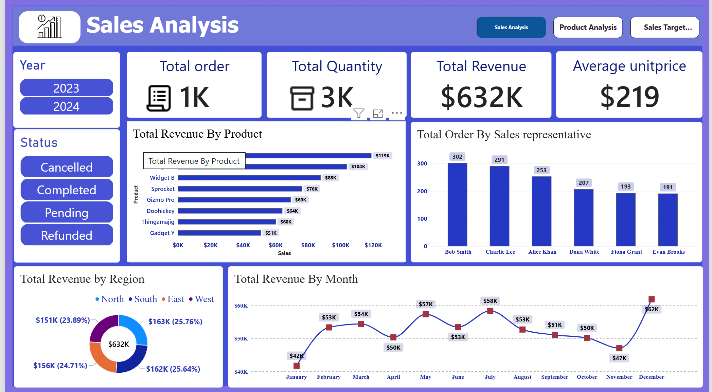
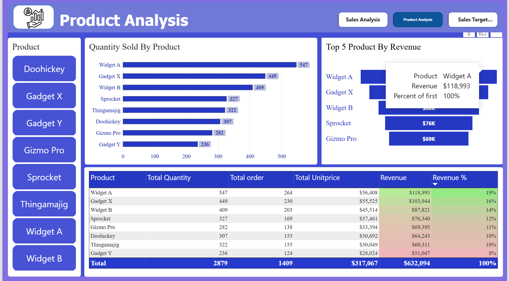
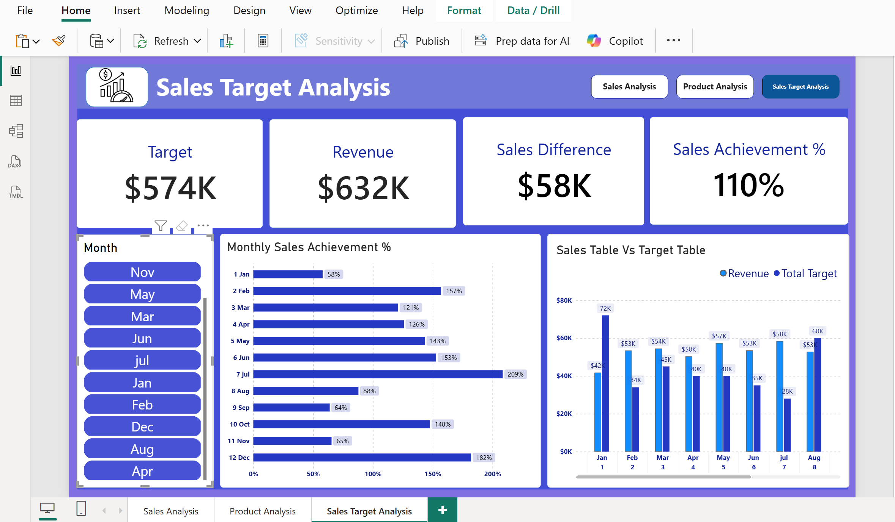

# Sales Analytics Using MySQL & Power BI

A data analytics portfolio project focused on sales data cleaning, SQL-based analysis, and interactive Power BI reporting.

## Project Overview

This project explores sales performance using MySQL and Microsoft Power BI. The workflow includes data preparation, SQL analysis, KPI development, and dashboard creation to help understand revenue trends, product performance, and sales targets.

## Tools & Technologies

- **Database:** MySQL
- **Query Language:** SQL
- **Business Intelligence:** Microsoft Power BI
- **Analytics & Visualization:** DAX, KPI reporting, interactive charts

## Project Workflow

1. Created a working copy of the raw sales dataset.
2. Identified and removed duplicate records.
3. Standardized inconsistent date formats and converted dates to the `DATE` data type.
4. Cleaned text fields and handled missing or invalid values.
5. Calculated sales revenue using quantity and unit price.
6. Performed SQL analysis using aggregate functions, CTEs, window functions, and `LAG()`.
7. Developed an interactive Power BI dashboard to explore sales performance.

## Power BI Dashboard

The report contains three dashboard pages.

### 1. Sales Analytics Overview

Provides a high-level view of sales performance, including revenue, order volume, quantity sold, and monthly trends.

### 2. Product Overview

Explores product-level revenue, quantity sold, and product contribution to overall sales.

### 3. Sales Target Analysis

Compares monthly sales performance with targets and highlights the difference between actual revenue and target values.

## SQL Analysis

The SQL scripts cover:

- Total sales records and quantity sold
- Total revenue and average unit price
- Product-level revenue analysis
- Top-performing products
- Product contribution to total revenue
- Cumulative revenue over time
- Month-over-month revenue growth

## Repository Files

- `01_data_cleaning.sql` — Data cleaning and preparation
- `02_sales_analysis.sql` — SQL analysis queries
- `Sales_Analytics_Overview.png` — Sales overview dashboard
- `Product_Overview.png` — Product analysis dashboard
- `Sales_Target_Analysis.png` — Sales target dashboard

## Key Skills Demonstrated

SQL data cleaning, data standardization, aggregations, CTEs, window functions, revenue analysis, Power BI dashboard development, DAX, and data visualization.

## Data Source

The project uses a sales dataset originally obtained from Kaggle. The data was used for SQL-based data preparation, sales analysis, and Power BI dashboard development.

*Add the exact Kaggle dataset URL here when available.*

## Author

**Jane Keerthana**  
Aspiring Data Analyst

**Skills:** MySQL, SQL, Power BI, Data Cleaning, Data Visualization
